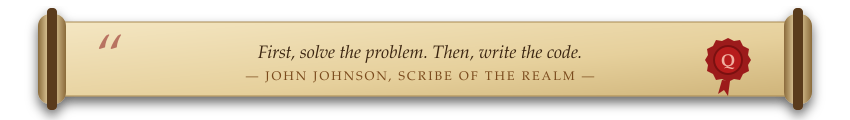
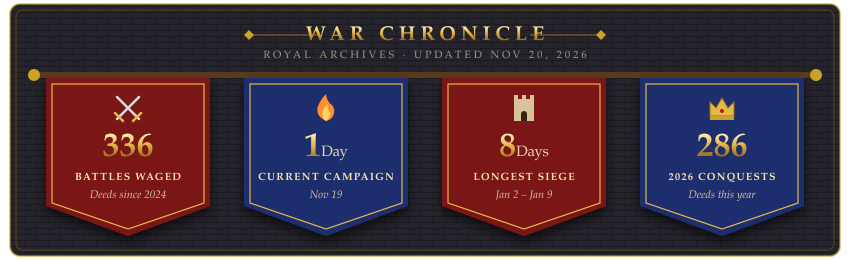
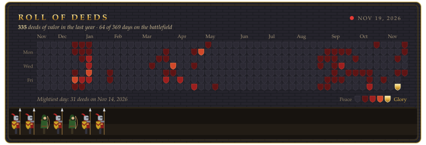

  <!-- ==================== CASTLE HEADER ==================== -->
  

    

  <!-- ==================== HERALDIC BADGES ==================== -->
  

    
    
    
    
  

   

  <!-- ==================== ABOUT: THE KNIGHT'S CHRONICLE ==================== -->
  

    

  

    

  

    
  
    

  <!-- ==================== STATS: HALL OF RECORDS ==================== -->
  

    

  

    

  <!-- Live GitHub Streak Stats -->
  

    
  

   
  
    

  <!-- ==================== CONTRIBUTION GRID: THE BATTLE LEDGER (auto-updated) ==================== -->
  

    

  

    
  
    

  <!-- ==================== ACTIVITY: THE MARCH OF COMMITS (auto-updated) ==================== -->
  

    

  

    
  
    

  <!-- ==================== CONTACT: SEND A RAVEN ==================== -->
  

    

  

    
    &nbsp;
    
    &nbsp;
    
    &nbsp;
    
  

   

  <!-- ==================== FOOTER: CASTLE GATE ==================== -->
  

