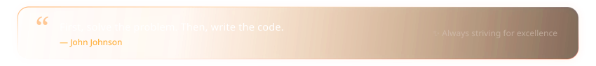
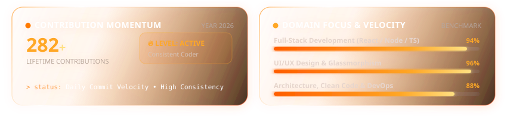
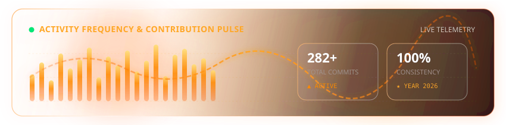
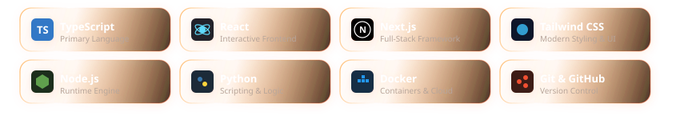

  <!-- ==================== ANIMATED GLASS HEADER ==================== -->
  

    

  <!-- ==================== QUICK STATUS BADGES ==================== -->
  

    
    
    
    
  

   

  <!-- ==================== FLOATING GLASS ABOUT MODULES ==================== -->
  

    

  <!-- Quote Card -->
  

    
  
    

  <!-- ==================== GITHUB STATS & STREAK ==================== -->
  

    

  <!-- Modular Animated Glass Stats Dashboard -->
  

    

  <!-- Live GitHub Streak Stats (Realtime Sync) -->
  

    
  

   
  
    

  <!-- ==================== LIVE ACTIVITY PULSE ==================== -->
  

    

  <!-- Futuristic Animated Contribution Wave & Telemetry -->
  

    
  
    

  <!-- ==================== CURATED TECH ARSENAL ==================== -->
  

    

  <!-- Curated Core Technologies in Floating Glass Tiles -->
  

    
  
    

  <!-- ==================== CONNECT & CONTACT ==================== -->
  

    

  

    
    &nbsp;
    
    &nbsp;
    
    &nbsp;
    
  

    

  <!-- ==================== FOOTER ==================== -->
  

